# Snake — retro arcade for Android

A small, complete Android game written in **Kotlin** with **Jetpack Compose**. You steer a neon snake around a
wrap-around board by **tapping** the screen or by **tilting** your phone. Sounds are synthesized in code (no audio
files), and the phone buzzes when you eat and when you crash.

This project is meant for teaching: the code is short, split into small files, and this README explains how every
part works.

> **About the screenshots:** they are renders of the approved design, not captures from a device. Real screens
> look the same apart from tiny font and spacing differences. Swap in your own captures any time (see `docs/screenshots`).

| Start screen | Playing (Tap mode) | Playing (Tilt mode) | Game over |
|:---:|:---:|:---:|:---:|
| 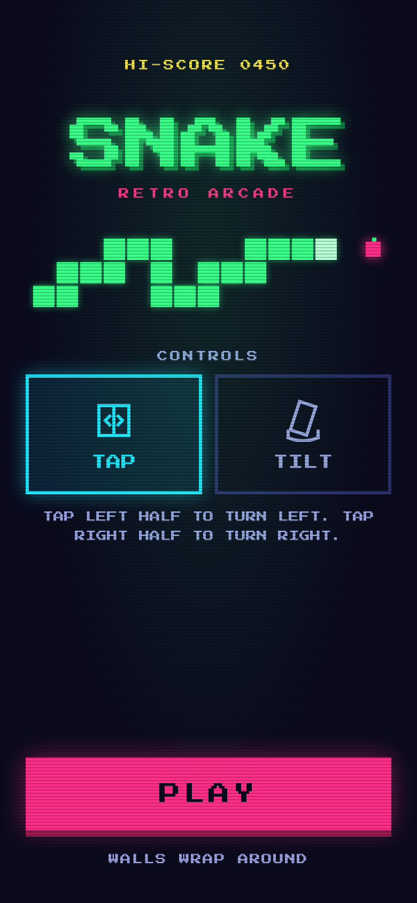 | 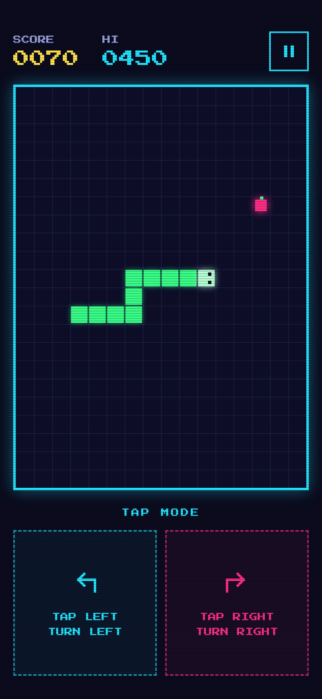 | 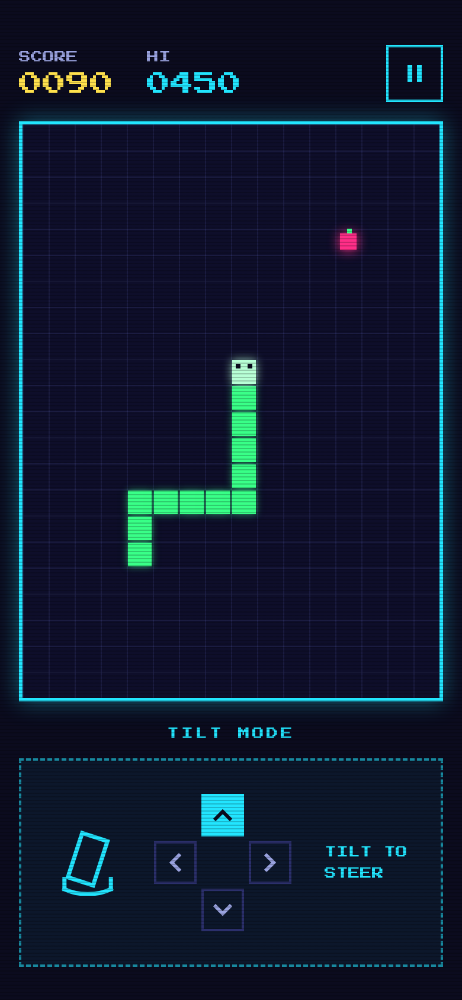 | 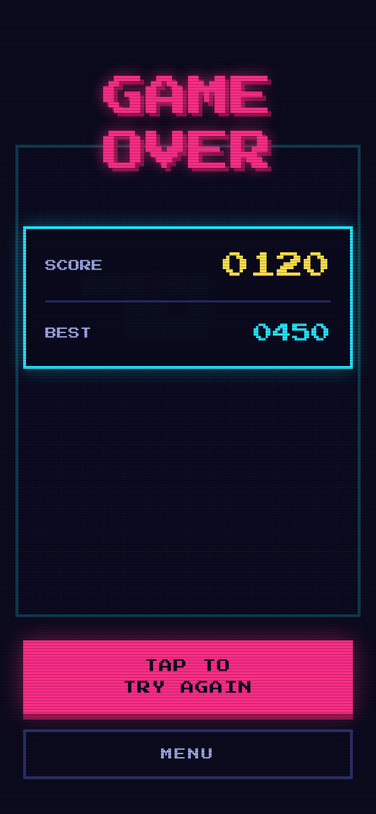 |

## Contents

1. [Run it](#run-it)
2. [How to play](#how-to-play)
3. [The big picture](#the-big-picture)
4. [Project layout](#project-layout)
5. [Screens and game phases](#screens-and-game-phases)
6. [The game loop](#the-game-loop)
7. [The rules (SnakeEngine)](#the-rules-snakeengine)
8. [Controls: Tap and Tilt](#controls-tap-and-tilt)
9. [Sound: a tiny synthesizer](#sound-a-tiny-synthesizer)
10. [Vibration and saved data](#vibration-and-saved-data)
11. [Tests](#tests)
12. [Versions and compatibility](#versions-and-compatibility)
13. [Ideas to extend it](#ideas-to-extend-it)
14. [Credits](#credits)

## Run it

1. Clone the repository and open the folder in **Android Studio** (developed for *Android Studio Rabbit 1 | 2026.2.1*).
2. Let **Gradle sync** finish. Use the JDK that comes with Android Studio (the project needs JDK 17 or newer).
3. Pick a phone or emulator running **Android 8.0 (API 26) or newer** and press **Run**.

Tips:

- **Tilt mode needs a real phone** (or an emulator with virtual sensors: *Extended controls → Virtual sensors*).
- If Android Studio offers to upgrade the Android Gradle Plugin, that is optional. The project builds as it is.
- Command line: `./gradlew assembleDebug` builds the APK, `./gradlew testDebugUnitTest` runs the tests.

## How to play

- Pick **TAP** or **TILT** on the start screen, then press **PLAY**. Your choice is remembered.
- Eat the magenta apples. Each one is worth **10 points** and makes the snake one cell longer.
- **Walls wrap around**: leave the right edge and you come back on the left.
- The only way to lose is to run into **your own body**.
- The speed never changes, so the challenge is the growing tail.
- **Pause** with the button in the corner, or the back button. The game also pauses by itself if you leave the app.

| Mode | How it steers |
|---|---|
| **Tap** | Tap the **left half** of the screen to turn 90° left. Tap the **right half** to turn 90° right (relative to where the snake is heading). |
| **Tilt** | Tilt the phone toward the direction you want, like a marble rolling on the screen. The angle you hold the phone at when the run starts counts as "level". |

## The big picture

The code is split into four jobs. The UI only *draws* and *forwards touches*; the rules live in plain Kotlin that
knows nothing about Android, which is what makes them easy to test.

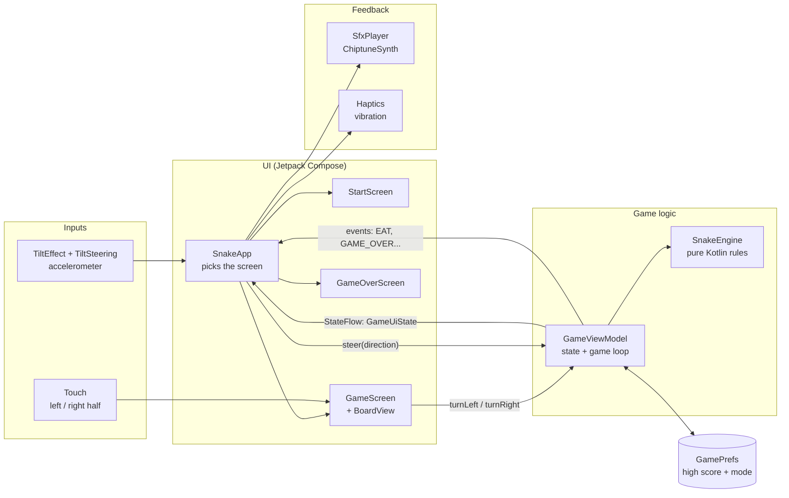

Two ideas to take away:

- **State flows down, events flow up.** The ViewModel publishes one immutable `GameUiState`; the screens are just a
  function of it. Taps and tilts call ViewModel functions.
- **One-off things are events, not state.** "A sound should play now" is a `GameEvent` (a `SharedFlow`), because it
  must happen once and not be remembered.

## Project layout

```
SnakeGame/
├── app/src/main/java/com/frozenfussion/snakegame/
│   ├── MainActivity.kt          Entry point: edge-to-edge, keeps the screen on, checks for a tilt sensor
│   ├── game/
│   │   ├── Direction.kt         UP / RIGHT / DOWN / LEFT and "turn left / right"
│   │   ├── Cell.kt              One board square (x, y)
│   │   ├── SnakeEngine.kt       The rules: move, wrap, eat, grow, die
│   │   └── GameViewModel.kt     Phases, state, the 150 ms game loop, events
│   ├── input/
│   │   ├── TiltSteering.kt      Accelerometer numbers  ->  a direction
│   │   └── TiltEffect.kt        Registers / unregisters the sensor listener
│   ├── audio/
│   │   ├── ChiptuneSynth.kt     Notes  ->  raw audio samples
│   │   ├── Sound.kt             The four sound effects, written as notes
│   │   └── SfxPlayer.kt         Plays the pre-rendered sounds
│   ├── haptics/Haptics.kt       Vibration patterns
│   ├── data/GamePrefs.kt        Saves high score and control mode
│   └── ui/
│       ├── Arcade.kt            Colors, pixel font, buttons, icons, scanlines
│       ├── SnakeApp.kt          Chooses the screen, wires sound / vibration / sensor
│       ├── StartScreen.kt
│       ├── GameScreen.kt        HUD, board, hints, pause overlay, tap handling
│       ├── GameOverScreen.kt
│       └── BoardView.kt         Draws the grid, snake and apple on a Canvas
├── app/src/test/…               Unit tests for the engine, tilt and synth
├── docs/                        Screenshots and the font license
└── gradle/libs.versions.toml    All library versions in one place
```

## Screens and game phases

The whole app is a small state machine. `GameViewModel` holds the current **phase** and `SnakeApp` shows the matching screen.

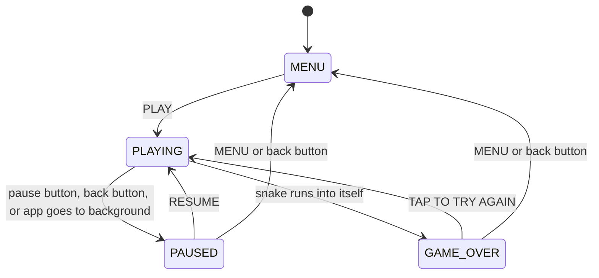

| Phase | Screen shown | Game loop running? |
|---|---|---|
| `MENU` | `StartScreen` | no |
| `PLAYING` | `GameScreen` | **yes** |
| `PAUSED` | `GameScreen` + pause overlay | no |
| `GAME_OVER` | `GameOverScreen` (final board shown dimmed behind) | no |

## The game loop

A game is just "update, draw, wait, repeat". Here the **update** is `SnakeEngine.step()`, the **draw** happens
automatically because Compose redraws when the state changes, and the **wait** is a coroutine `delay`.

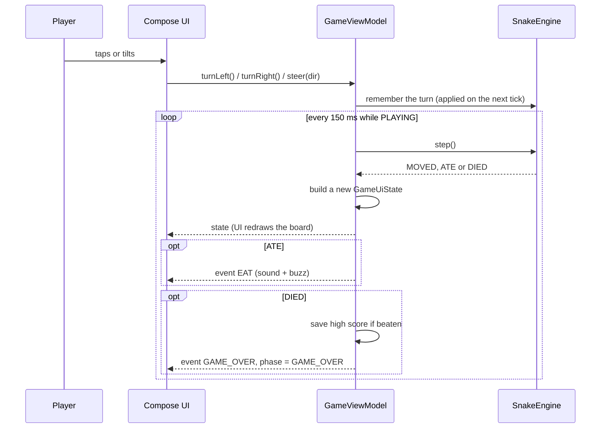

The speed is constant: `TICK_MS = 150` (about 6.7 moves per second). It is one line in `GameViewModel.kt` if you want to experiment.

## The rules (SnakeEngine)

`SnakeEngine` has no Android imports at all. You give it commands (`turnLeft`, `steer`, `step`) and read back the snake, the food and the score.

**The board** is a 16 × 22 grid. `(0, 0)` is the top-left cell, `x` grows to the right and `y` grows **downward**.

```
        x → 0   1   2  …  15
   y  0   ┌───┬───┬───┬───┬───┐
   ↓  1   │   │   │   │   │   │      The snake is a list of cells,
      2   │   │ ● │ ● │ ◉ │   │      head first, tail last.
      …   │   │   │   │   │   │      ◉ = head   ● = body
     21   └───┴───┴───┴───┴───┘
```

**Wrapping** is one line of maths. `floorMod` keeps the result between `0` and `cols - 1`, even for `-1`:

```kotlin
x = Math.floorMod(head.x + direction.dx, cols)   // 15 + 1 -> 0,   0 - 1 -> 15
y = Math.floorMod(head.y + direction.dy, rows)
```

**One tick** (`step()`):

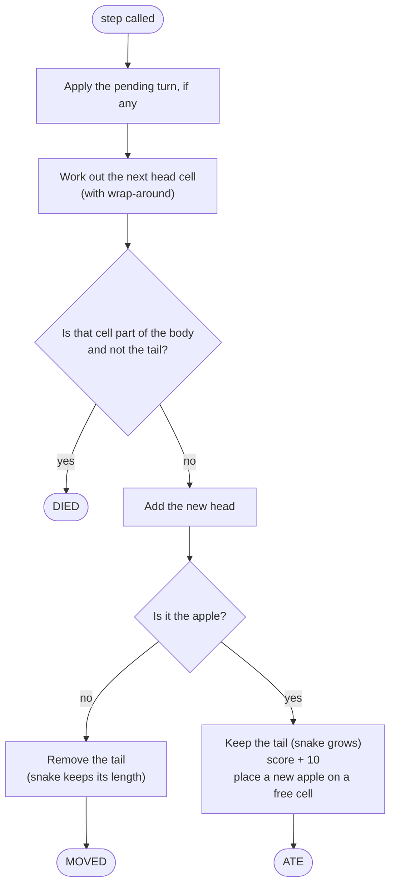

Two details worth pointing out to students:

- **Stepping onto the tail is safe** because the tail moves away in the same tick. That is why the check says "not the tail".
- **You can't reverse into your own neck.** In Tilt mode `steer()` ignores the opposite direction; in Tap mode a turn is always 90°, so reversing can't happen.

## Controls: Tap and Tilt

### Tap

In Tap mode the **whole screen** is the controller. `GameScreen` listens for the first finger-down and checks which half it landed on:

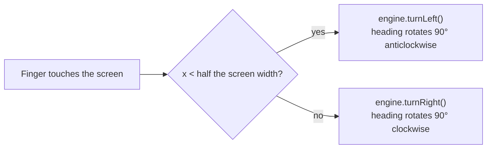

It reacts on finger-**down**, not on release, so the game feels instant. Turns are relative: when the snake heads
`UP`, "turn right" makes it go `RIGHT`; when it heads `DOWN`, "turn right" makes it go `LEFT`.

### Tilt

Phones have an **accelerometer** that feels gravity. Hold the phone still and it reports which way "down" is, which tells us how the phone is tilted.

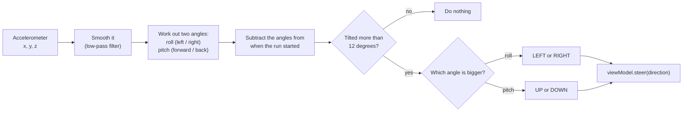

| You do this | Roll / pitch change | Snake goes |
|---|---|---|
| Lower the **right** edge | roll gets smaller | RIGHT |
| Lower the **left** edge | roll gets bigger | LEFT |
| Lower the **top** edge (lean it back) | pitch gets smaller | UP |
| Raise the **top** edge (tip it toward you) | pitch gets bigger | DOWN |

Why it feels good:

- **No calibration screen.** The angle you hold the phone at when the run begins becomes "level", so it works whether you play lying down or sitting up.
- **Dead zone.** Small wobbles under 12° are ignored so the snake doesn't twitch.
- **Smoothing.** Each new reading is blended with the previous ones to remove jitter.
- **Only listens while playing.** `TiltEffect` registers the sensor when you start and unregisters it on pause or game over, which saves battery.

## Sound: a tiny synthesizer

There are **no audio files** in this app. At start-up `ChiptuneSynth` turns a list of notes into raw sound samples, the way old game consoles did, and `SfxPlayer` keeps them in memory ready to play.

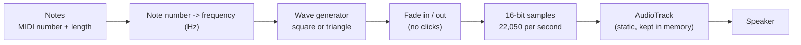

**MIDI-style notes.** Each note is a number, like MIDI: `60` is middle C, `69` is the A above it (440 Hz), and each +1 is one semitone up. The frequency is:

```
frequency = 440 × 2 ^ ((note − 69) / 12)
```

So adding 12 to a note number doubles the frequency, which is exactly one octave.

**Wave shapes.** A **square wave** flips between +1 and −1 (harsh, buzzy, very "8-bit"). A **triangle wave** ramps up and down (softer, used for the sad game-over tune).

```
square:   ┌──┐  ┌──┐  ┌──┐          triangle:   /\    /\    /\
          │  │  │  │  │  │                     /  \  /  \  /  \
       ───┘  └──┘  └──┘  └──                      \/    \/    \/
```

**The four sounds** (all in `Sound.kt`):

| Sound | When | Notes |
|---|---|---|
| `START` | PLAY pressed | C5 → E5 → G5 → C6, a rising arpeggio |
| `EAT` | Apple eaten | E5 → B5, a quick two-note blip |
| `GAME_OVER` | You crash | G4 → E4 → C4 → G3, falling triangle notes |
| `CLICK` | Menu buttons | One short A5 beep |

## Vibration and saved data

- **`Haptics`** gives a short 30 ms buzz when you eat and a longer buzz-pause-buzz pattern when you crash. It uses the `VIBRATE` permission and quietly does nothing on phones without a vibrator.
- **`GamePrefs`** stores two values in `SharedPreferences`: the **high score** and your **control mode** (Tap or Tilt). They are still there the next time you open the app.

## Tests

The rules, the tilt maths and the synthesizer are plain Kotlin, so they run as fast unit tests on your computer, with no phone needed:

```
./gradlew testDebugUnitTest
```

| Test file | What it checks |
|---|---|
| `SnakeEngineTest` | start state, movement, wrapping on both axes, no reversing, relative turns, growing and scoring, dying on your own body |
| `TiltSteeringTest` | dead zone, all four directions, "starting angle counts as level" |
| `ChiptuneSynthTest` | note-to-frequency maths, correct length, silence for rests, no clipping |

The screens, sensors, sound and vibration are not covered by automated tests; they need a device to try out.

## Versions and compatibility

| Item | Value |
|---|---|
| Android Studio | Rabbit 1 \| 2026.2.1 (supports AGP 7.1 – 9.4) |
| Android Gradle Plugin | 8.13.2 |
| Gradle | 8.13 (via the wrapper) |
| Kotlin | 2.2.20 |
| Compose BOM | 2025.09.00 |
| `minSdk` | 26 (Android 8.0) |
| `targetSdk` | 35 |
| `compileSdk` | 36 |
| Orientation | Portrait only |

The app was deliberately kept off the newest Android API so that more phones can run it. Dependencies are kept to the minimum:
Compose UI and foundation, Activity, Lifecycle, and Core KTX. There is no Material library, no navigation library and no database.

## Ideas to extend it

- Speed up a little every few apples (change `TICK_MS` into a variable).
- Add a looping chiptune background tune using the same synthesizer.
- Add a mute switch for sound and vibration.
- Add obstacles, or a second kind of apple worth more points.
- Show "NEW BEST!" on the game-over screen when you beat the high score.
- Write a unit test for a new rule before you write the rule.

## Credits

The pixel font is **Press Start 2P** by The Press Start 2P Project Authors, used under the SIL Open Font License 1.1 (see `docs/OFL-PressStart2P.txt`).
